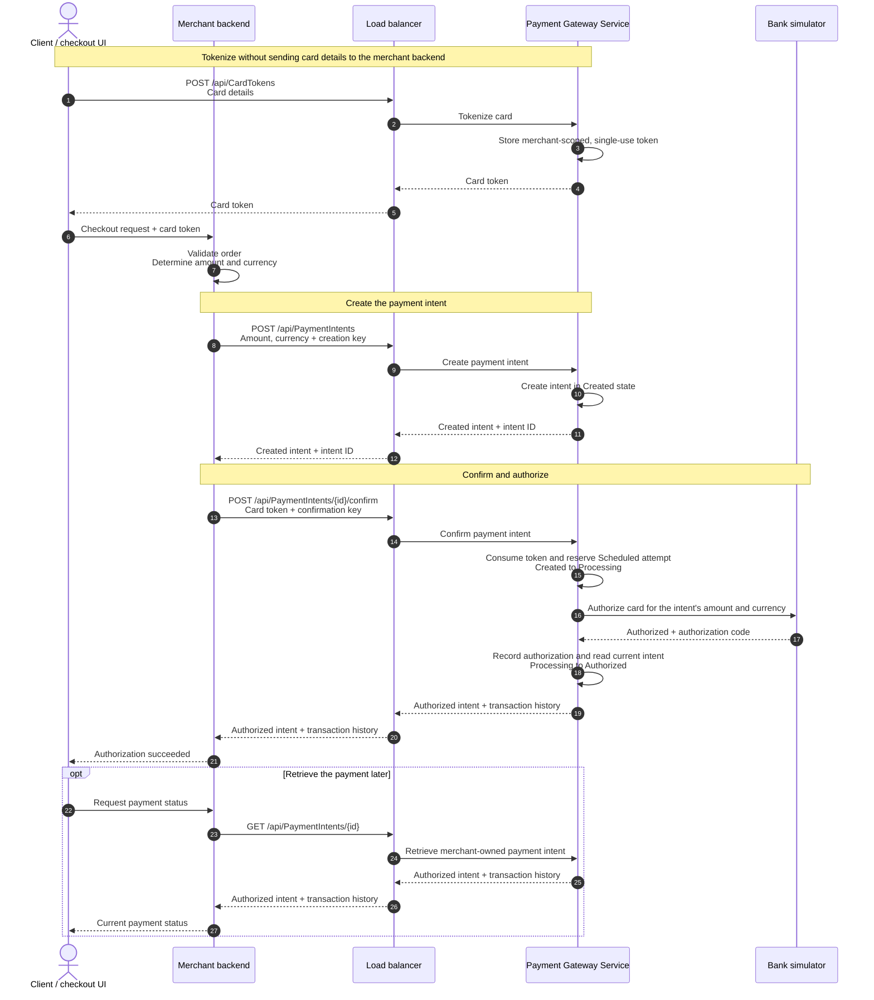
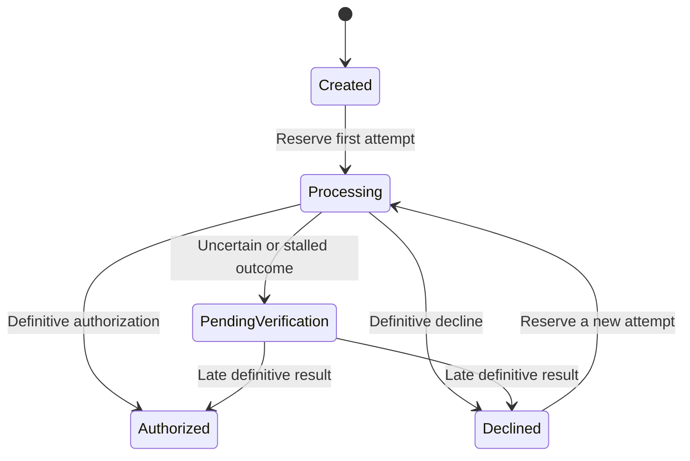

# Payment Gateway Service Design

## 1. Purpose and Design Goals

This service implements a merchant-facing payment gateway for the
[Checkout.com engineering assessment](https://github.com/cko-recruitment).
It separates card tokenization, payment intent creation, bank authorization, and
retrieval of payment history.

The design prioritizes:

- **Payment safety:** distinguish a definitive decline from an unknown bank
  outcome, and avoid submitting another attempt merely because a response was lost.
- **Merchant isolation:** derive ownership from verified API keys and apply it
  consistently to tokens, intents, attempts, and idempotency records.
- **Predictable concurrency:** reserve attempts and consume tokens without allowing
  concurrent requests to create duplicate work.
- **Data minimization:** keep raw card details out of payment history, normal logs,
  and telemetry attributes.
- **Operational clarity:** make uncertain outcomes, stalled attempts, and service
  failures visible.
- **Assessment-appropriate simplicity:** use an in-memory database substitute,
  small service boundaries, and a single deployable application.

## 2. Scope, Assumptions, and Non-Goals

### Functional scope

The gateway can issue card tokens per merchant, create payment intents,
confirm them against a bank simulator, and retrieve the current intent with its
transaction history. Supported currencies are GBP, USD, and EUR. Amounts are
positive 32-bit integers expressed in the currency's minor unit.

An `Authorized` result represents the simulator's authorization decision. This
service does not model capture, settlement, refunds, or a financial ledger.

### Assumptions

- **An in-memory test double represents the database.** Tokens, payment state,
  idempotency records, and change events are process-local and lost on restart.
  The intended deployment is one gateway instance, not a distributed payment system.
- **An upstream failure does not prove that no payment was attempted.** A timeout,
  disconnected request, invalid response, or bank HTTP 503 can leave the actual bank
  outcome unknown. The gateway must not silently convert uncertainty into decline.
- **The bank exposes only a synchronous payment endpoint.** There is no
  transaction-status lookup or callback mechanism available to resolve uncertainty.
- **Local infrastructure is a development environment.** Public fake API keys
  and security-disabled observability services are not production configurations.

### Explicit non-goals

- **Request signing:** merchant authentication uses bearer API keys, not signed
  request bodies. Internal request fingerprints are not authentication signatures.
- **Bank transaction webhooks:** no callback endpoint, signature verification,
  callback deduplication, or asynchronous bank-event ingestion is implemented.

## 3. Architecture and Responsibility Boundaries

The client and merchant backend are separate integration actors outside this
repository. Card tokenization goes from the client to the Payment Gateway Service
without passing through the merchant backend. Payment-intent creation, confirmation,
and retrieval go through the merchant backend. Both paths enter through the load
balancer shown in the deployment architecture.


[Open the full-size SVG](images/payment-gateway-architecture.svg).

The load balancer represents external deployment infrastructure; it is not included
in the local Compose stack. It does not imply that this implementation supports
multiple gateway instances: payment state, tokens, idempotency, and rate limits
remain process-local.

The gateway is organized into four explicit layers:

1. **Middleware:** request policies, authentication, authorization, and HTTP telemetry.
2. **Controllers:** HTTP handlers, model binding, input validation, and response mapping.
3. **Application services and background services:** separate, color-coded groups
   within the same layer. Reconciliation and the timeout sweeper are distinct services.
4. **Repositories and integrations:** repositories and Change Data Capture (CDC)
   sit alongside the separately colored bank integration. CDC is implemented as an
   in-memory event queue, not database-log-based change capture.

Observability spans all four layers rather than forming another layer. Solid
arrows show selected API, state, and event dependencies; dashed arrows show
telemetry export. This is a component view, not an execution sequence or an
exhaustive call graph. HTTP responses return over their corresponding request paths.

The gateway returns the card token directly to the client. The client then passes
that token, rather than PAN/CVV, to the merchant backend. The backend owns checkout
orchestration, validates order details and amounts, supplies payment idempotency
keys, and relays gateway results to the client. Those merchant-side responsibilities
are not implemented by this gateway.

| Component | Responsibility |
|-----------|----------------|
| Client / checkout UI | Submit card details directly for tokenization; send the resulting token and checkout requests to the merchant backend |
| Merchant backend | Own order/payment orchestration and call the gateway's payment-intent endpoints using server-side API keys |
| Load balancer | Route client and merchant-backend requests to the service as external deployment infrastructure |
| API composition and lifecycle | Construct dependencies, register routes, and supervise HTTP and background workers |
| Middleware | Request correlation, cache policy, admission control, authentication, authorization, idempotency-header validation, and HTTP telemetry |
| Controllers and model binding | Validate HTTP input and map service outcomes to stable response contracts |
| Application services | Coordinate business operations, token consumption, bank calls, and outcome recording |
| Repositories | Enforce ownership, idempotency, state transitions, and consistent in-process mutations |
| Change Data Capture (CDC) | Publish and consume repository change events through an in-process, non-durable FIFO queue |
| Bank adapter | Encapsulate the external HTTP contract and classify transport/protocol failures |
| Reconciliation service | Observe change events and log unresolved outcomes without retrying bank calls |
| Timeout sweeper | Mark locally stalled, scheduled attempts as pending verification |

The API retains services and workers rather than exposing repositories as direct
API dependencies. Dependencies are injected through interfaces where substitution
is useful, especially for the bank and storage boundaries.

Static input validation belongs at the HTTP boundary. Time-sensitive checks and
business invariants remain in services and repositories. Internal callers must
supply validated requests and trusted metadata; the design does not duplicate
every HTTP validation rule throughout the stack.

### Successful Payment Authorization

The following sequence shows one successful checkout with valid API keys, fresh
creation and confirmation idempotency keys, and an unused card token. Gateway
self-messages summarize service and repository work; middleware, background workers,
and observability are omitted. The external load balancer and client API key
boundaries described above still apply.



Confirmation already returns the payment intent and its transaction history, so a
separate retrieval is optional. `Authorized` means bank authorization, not capture
or settlement. Tokenization is shown first here, but intent creation can precede
it; both must complete before a new confirmation attempt.

## 4. Authentication, Authorization, and Card Data Protection

### Merchant identity and permissions

An API key identifies a merchant and grants explicit endpoint scopes. The server
stores a SHA-256 hash of the API key payload, excluding the `sk_` prefix, and
compares hashes in constant time. This avoids retaining a directly usable API key
in the authentication configuration; it still assumes strong API keys outside
development.

Scopes are independent: token creation, intent creation, confirmation, and retrieval
can be granted separately. Authentication and scope checks occur before request
model binding. Invalid API keys produce 401; missing permissions produce 403.

The direct-client tokenization path must not expose the merchant backend's API key
with payment-intent permissions. Client authorization should be limited to
tokenization and bound to the intended merchant. The current gateway supports
separately scoped static API keys, but does not implement a publishable API key
or short-lived client-session mechanism. A production browser integration also needs
an appropriate origin/CORS policy when the gateway is on another origin. These
client-integration controls remain to be designed; the diagram does not imply
that a production browser SDK or client API key provisioning already exists.

Ownership is a separate rule from permissions. A merchant with read permission
still cannot retrieve another merchant's intent. Missing and foreign intents
both produce 404, avoiding disclosure of another merchant's resources. Client
headers cannot substitute an unverified merchant identity.

### Card tokenization and data lifecycle

A token is a merchant-bound, single-use reference to card details:

1. Validate card syntax and expiry.
2. Generate a canonical UUIDv7 token and assign a 15-minute lifetime.
3. Store the card details under the merchant and the token's SHA-256 hash.
4. Return the plaintext token once to the client, which passes it to the merchant
   backend for payment confirmation.
5. On a new confirmation attempt, consume the token atomically and remove its
   repository entry.

Tokenization and intent creation are independent preparation operations; either
can occur first. The merchant backend's payment-intent requests carry a token
rather than PAN/CVV, so it need not receive raw card details in this integration.
Payment records retain only the last four digits and expiry information.
Card expiry is also checked at consumption, since it may have changed since issuance.

Expiry is enforced at the exact token deadline, but cleanup is lazy: expired entries
are removed during consumption attempts, not by a dedicated cleanup worker.
Consequently, an expired token is unusable even if its raw card data has not yet
been physically removed from memory.

### Compliance boundary

The gateway still receives PAN/CVV, temporarily holds them in process memory, and
sends them to the bank. Go garbage collection is not secure memory erasure.
UUIDv7 tokens also contain time information and are not equivalent to a dedicated
high-entropy vault-token design.

Production use would require an appropriate card-data handling architecture,
transport protection, access controls, retention policies, and compliance review.
The current tokenization design is a data-minimization measure, not a compliance
claim. Normal application logs exclude card bodies and tokens; explicitly enabled
development-test transcripts are a separate, unredacted diagnostic facility.

## 5. Payment Lifecycle and Consistency

### Domain model

| Entity | Meaning |
|--------|---------|
| Card token | A short-lived, merchant-owned reference that can fund one new attempt |
| Payment intent | The merchant's payment request: fixed amount/currency, current state, and associated history |
| Bank transaction | One authorization attempt, with its own status, masked card snapshot, timestamps, and originating request ID |
| Change event | A creation snapshot or update delta used for operational observation |

A payment intent can have several attempts after definitive declines. History is
returned oldest first. Public responses omit full card details, internal
fingerprints, idempotency keys, and bank authorization codes.

The following tables use the Go domain field names. **Public API** indicates whether
the field is included in the response models, rather than whether it can be
serialized from the internal entity.

#### Payment intent fields

The [payment intent](internal/models/payment_intent.go) owns the payment's fixed
amount and currency, current business state, and attempt history.

| Field | Type | Purpose | Public API |
|-------|------|---------|------------|
| `PaymentIntentID` | `string` | Gateway-generated UUIDv7 identifying the payment intent throughout its lifecycle. | Yes |
| `MerchantID` | `string` | Owner derived from the authenticated API key; used to enforce merchant isolation. | No |
| `Status` | `PaymentIntentStatus` | Current business state: `Created`, `Processing`, `Authorized`, `Declined`, or `PendingVerification`. | Yes |
| `Currency` | `string` | Fixed currency for all attempts: GBP, USD, or EUR. | Yes |
| `Amount` | `int32` | Fixed positive amount in the currency's minor unit; all attempts authorize this amount. | Yes |
| `IdempotencyKey` | `string` | Merchant-scoped creation idempotency key, allowing repeated creation requests to resolve to the same intent. | No |
| `RequestFingerprint` | `string` | HMAC-SHA256 fingerprint of the creation request's amount and currency; detects changed input under an existing creation key. | No |
| `BankTransactions` | `[]BankTransaction` | Associated authorization attempts, returned oldest first; empty before the first attempt. | Yes, using the public transaction fields below |

#### Bank transaction fields

A [bank transaction](internal/models/bank_transaction.go) represents one reserved
authorization attempt. Its amount and currency come from the parent intent; its
card snapshot contains neither PAN/CVV nor the card token.

| Field | Type | Purpose | Public API |
|-------|------|---------|------------|
| `BankTransactionID` | `string` | Gateway-generated UUIDv7 identifying this attempt, not an identifier assigned by the bank. | Yes |
| `PaymentIntentID` | `string` | Links the attempt to its parent intent; not repeated in the public transaction nested under that intent. | No |
| `MerchantID` | `string` | Owner of the attempt, matching the parent intent's merchant. | No |
| `Status` | `BankTransactionStatus` | Attempt-specific state: `Scheduled`, a definitive bank decision, or an uncertainty reason detailed in the state model below. | Yes |
| `CardNumberLastFour` | `string` | Last four digits of the card used for this attempt; the full card number is not retained here. | Yes |
| `ExpiryMonth` | `int` | Expiry month copied from the consumed token's card details. | Yes |
| `ExpiryYear` | `int` | Expiry year copied from the consumed token's card details. | Yes |
| `CreatedAt` | `time.Time` | UTC time the attempt was reserved; also used to detect locally stalled attempts. | Yes |
| `IdempotencyKey` | `string` | Merchant-scoped confirmation idempotency key; matching replays reuse this attempt rather than submitting another bank request. | No |
| `RequestFingerprint` | `string` | HMAC-SHA256 fingerprint binding the confirmation to its intent ID and card token; detects conflicting reuse of the confirmation key. | No |
| `OriginatingRequestID` | `string` | Identifies the confirmation request that first reserved the attempt; retained for correlation, including subsequent change events. | No |
| `CompletedAt` | `*time.Time` | Nil while `Scheduled`; otherwise the UTC time the gateway recorded the latest outcome, including uncertainty or a later refinement. It is not a settlement timestamp. | Yes, nullable |
| `AuthorizationCode` | `*string` | Optional bank-supplied code; a nonblank value is required for a successful authorization. Retained internally, not returned to the merchant. | No |

The HTTP response also includes `request_id`, identifying the current request.
It is response metadata, not a payment-intent field, and is distinct from the
attempt's retained `OriginatingRequestID`.

### Two-step intent workflow

**Create:** the merchant backend asks the gateway to record the intended amount
and currency without contacting the bank. This gives the backend a stable resource
and supports retries before payment submission.

**Confirm:** the merchant backend submits the client-provided card token and a
confirmation idempotency key. The gateway reserves an attempt, calls the bank, and
records the result. Retrieval requests also go through the merchant backend.
This is not an authorization/capture split or a distributed two-phase commit.

For a new confirmation:

1. Check merchant ownership and whether the key identifies a replay or conflict.
2. Check whether the intent permits a new attempt.
3. Consume the token and reserve a `Scheduled` bank transaction, moving the intent
   to `Processing`.
4. Release repository locks before making the external HTTP call.
5. Record a definitive or uncertain outcome and expose the resulting intent state.

### In-process consistency

A single payment-repository mutex serializes idempotency checks, state checks,
attempt reservation, and completion. Token consumption uses the card repository's
own mutex while reservation is serialized. Returned snapshots are detached from
stored state so callers cannot mutate repository data indirectly.

This deliberately simple approach makes races easier to reason about:

- One token cannot be consumed by two competing intents.
- Concurrent matching confirmations reuse one reserved attempt.
- An intent cannot start another attempt while processing, authorized, or pending
  verification.
- A timeout sweep must recheck the attempt before changing it, so a concurrent
  completion can win safely.

These are **concurrency guarantees, not database transaction guarantees**. There
is no general rollback across token consumption, attempt creation, and event
publication. For example, a later failure can occur after a token has been consumed;
publication failure can occur after payment state has already changed.

The trade-off is limited scalability: payment operations share a lock, and
in-memory collections are scanned. This is suitable for the assessment, not a
substitute for transactional storage and indexed queries.

### State model

The intent summarizes business progress; the bank transaction preserves the
specific attempt outcome.

| Bank transaction status | Payment intent state | Interpretation |
|-------------------------|----------------------|----------------|
| No attempt | `Created` | Ready for confirmation |
| `Scheduled` | `Processing` | Reserved; bank submission/completion is in progress |
| `Authorized` | `Authorized` | Definitive authorization |
| `Declined` | `Declined` | Definitive decline; a new attempt is permitted |
| `ServiceUnavailable`, `NetworkError`, `InvalidResponse`, `RequestTimeout`, `RequestCanceled`, `StatusUpdateTimeout` | `PendingVerification` | No reliable final bank decision |



Only `Created` and `Declined` permit new attempts. A pending attempt may be refined
by a valid completion of the already-running operation; the repository supports
this transition, but there is no bank verification endpoint or webhook to fetch
such a result independently. Definitive outcomes of an individual bank transaction
cannot be changed into another outcome.

`CompletedAt` records a gateway outcome transition, including uncertain outcomes.
It is not proof of settlement or proof that the bank did not process a request.

### Idempotency and replay semantics

Idempotency prevents repeated side effects, rather than caching an immutable HTTP
response. Creation and confirmation use separate merchant-scoped key namespaces.

| Operation | Fingerprinted request |
|-----------|-----------------------|
| Intent creation | Currency and amount |
| Confirmation | Intent ID and card token |

Fingerprints use HMAC-SHA256 over the typed request data, with an in-memory
repository key. A matching key and fingerprint return the current snapshot.
Different details under a previously reserved key produce a conflict.

Confirmation replay is checked before token availability and payability. Therefore
a matching retry can succeed after token consumption or expiry without consuming
another token or submitting another bank request. Validation failures that precede
reservation do not permanently reserve the key.

Responses describe the **current intent**, including later history:

| Current intent state on a matching confirmation replay | HTTP response |
|--------------------------------------------------------|---------------|
| `Authorized` or `Declined` | 200 with current intent and full history |
| `Processing` | 409 with attempt context |
| `PendingVerification` | 202 with current intent, full history, and a Location lookup URL |

For example, replaying an old declined attempt after a newer attempt authorizes
returns the authorized intent. The old attempt remains declined in history.
Clients must not interpret the aggregate status as a changed outcome for that
specific old attempt.

Idempotency records, fingerprints, and keys are not durable. These semantics do
not provide exactly-once execution across crashes, restarts, or multiple gateway
instances, and the bank protocol does not provide a coordinated transaction with
local storage.

## 6. Bank Integration and Uncertain Outcomes

The bank adapter has a deliberately narrow success contract: HTTP 200 with an
explicit boolean authorization decision, and a nonblank authorization code when
authorized. Missing or malformed decisions are errors, never implicit declines.

The adapter bounds the entire request, including response-body reads, and limits
response size. It does not follow redirects or add an application-level retry
policy. This limits resource exposure and avoids forwarding card data to a
redirected destination.

The important distinction is:

- **Declined:** the bank provided a valid, definitive refusal. The merchant may
  create a new attempt using a new token/key.
- **Pending verification:** the outcome is uncertain. Retrying under a new key
  could duplicate a real bank operation, so the intent is blocked from new attempts.

Likewise, client cancellation is not evidence that the bank stopped processing.
The service records recognized uncertain outcomes when possible, although a
disconnected caller may receive no response. Unexpected internal errors propagate
rather than being disguised as a bank decision.

Automatic recovery is constrained by the bank simulator's limited contract. For a
valid request, the card number determines the authorization decision or simulated
HTTP 503. Repeating the same bank request repeats that configured outcome, although
an authorization code may change. The simulator exposes no transaction-status or
verification API, so resubmission cannot verify the result of an earlier attempt.

The gateway therefore avoids automatic resubmission and retains
`PendingVerification` unless the original in-flight request later yields a
definitive result.

## 7. Background Reconciliation and Timeout Recovery

### Change Data Capture (CDC)

The repository acts as a test double for database storage, and its change events
simulate a database CDC feed. Creating a bank transaction or updating its outcome
produces a corresponding event through the CDC abstraction.

Events are delivered in publication order through a FIFO queue. Each event carries
a sequence number and the original confirmation request ID, linking background
observation to the payment attempt that caused the change.

The reconciliation service consumes these events asynchronously, logs transaction
changes, and highlights outcomes requiring verification. This provides operational
visibility into payment progress and unresolved attempts while keeping observation
separate from payment request handling.

### Recovery from a failed database status update

The timeout worker models recovery from a production failure in which **the bank
API has returned a decision, but the subsequent database update fails**. The bank
call and local status update are separate operations: the bank may have authorized
the payment while the stored bank transaction remains `Scheduled` and its payment
intent remains `Processing`.

The repository test double represents the database, and a stale `Scheduled`
attempt models this missing status update. The background sweep detects such
records so that they do not remain indefinitely in progress.

The timeout worker runs a sweep on startup and then periodically. An attempt is
eligible when it is still `Scheduled`, has no completion time, and:

```text
current time - creation time >= configured status-update timeout
```

Each sweep processes a bounded batch. The repository rechecks eligibility under
its mutation lock, then marks `StatusUpdateTimeout`, moves the intent to
`PendingVerification`, and emits the corresponding CDC event.

`StatusUpdateTimeout` identifies a missing recorded outcome, not a bank decline.
The transition makes the unresolved status visible to the reconciliation service
and keeps new attempts blocked, avoiding resubmission of a payment the bank may
already have authorized. If the original operation later records a definitive
result, it can refine the existing attempt without submitting another payment.

## 8. Resilience and Service Lifecycle

### Admission control

A global sliding-window limiter admits at most the configured number of requests
in any rolling second; the default is 100 per process. It covers all routes except
`GET /ping`, which remains available for health checks. Rejections return 429 and
`Retry-After: 1` before authentication and payment processing.

The limiter is shared across merchants and routes, not a per-merchant quota.
It does not bound in-flight concurrency, provide fairness, or protect an entire
multi-instance deployment.

### Bounded work and failure handling

| Control | Design purpose |
|---------|----------------|
| 1 MiB HTTP request-body limit | Bound model-binding input |
| 64 KiB bank response limit | Bound untrusted upstream data |
| Configurable bank timeout | Avoid indefinitely blocked authorization calls |
| Bounded timeout-sweep batches | Limit work performed by each recovery pass |
| Bounded asynchronous telemetry queues and export timeouts | Keep observability outages off the payment response path |

The HTTP server and both background workers share a supervised lifecycle.
Unexpected worker failure stops the server and sibling worker rather than leaving
a partially functioning instance running unnoticed.

Cancellation propagates to active work. HTTP shutdown uses a fresh bounded context
after cancellation, and observability gets a separate bounded flush phase. This
does not guarantee completion of in-flight bank operations or draining of all
change events. The liveness endpoint does not assert bank or telemetry availability.

## 9. Observability

Logs, metrics, and traces share a service identity and use OpenTelemetry to reach
the Collector, which owns Elasticsearch-specific export. JSON console logging
remains independent of that infrastructure.

| Signal | Current scope and purpose |
|--------|---------------------------|
| HTTP logs | INFO for card-token/payment-intent route families, including errors; route template, method, status, latency, request ID |
| Change-event logs | Redacted creation/update events with request, intent, and transaction IDs |
| Pending-verification warnings | Highlight outcomes that cannot be resolved automatically |
| HTTP metrics | Request counts, non-5xx counts, and duration histograms by method, route template, and status |
| Traces | One server span around the card-token handler, with upstream trace-context propagation |

Metrics use delta counts and aggregatable histograms:

- **QPS:** admitted and rejected HTTP requests recorded in the instrumented route
  families, divided by the query/bucket duration.
- **HTTP success rate:** non-5xx responses divided by all recorded responses.
  This intentionally includes 4xx responses and is not the payment authorization rate.
- **P95 latency:** an estimate from merged histograms, not an average of independently
  calculated percentiles.

Request IDs connect HTTP logs with asynchronous bank-event logs. Replays receive
new request IDs, while transaction events retain the originating attempt's ID.
Metric dimensions exclude high-cardinality request and transaction identifiers.

Export is best effort. Queues can overflow, failed delta exports can undercount
metrics, and shutdown may leave telemetry undelivered. Telemetry is therefore
diagnostic evidence, not the authoritative payment record or a durable audit trail.

Kibana supplies the
[Payment Gateway Dashboard](http://localhost:5601/app/dashboards#/view/payment-gateway-dashboard),
which combines HTTP throughput, success rate, P95 latency, gateway logs, and
card-token traces in a single view. Separate data views support exploration of each
signal. Startup provisions stable saved-object IDs without replacing existing
customizations.

> **Note:** The dashboard is available after starting the observability stack and
> completing its automatic setup. Follow the observability option in
> [Running in Docker](#running-in-docker).

The trace panel is currently a span table: Jaeger-style waterfalls, nested
card-operation spans, and full payment/bank tracing are not implemented.


*Screenshot captured after an E2E test run, showing the resulting metrics, logs, and traces.*

## 10. API Contract and Documentation

| Endpoint | Responsibility | Main success response |
|----------|----------------|-----------------------|
| `POST /api/CardTokens` | Tokenize validated card details | 200 with token and expiry |
| `POST /api/PaymentIntents` | Create or replay an intent | 201 with current intent and Location |
| `POST /api/PaymentIntents/{id}/confirm` | Submit or replay a confirmation | 200 for a definitive authorization or decline; 202 with Location for pending verification |
| `GET /api/PaymentIntents/{id}` | Retrieve merchant-owned current state/history | 200 for an existing owned intent |

Creation, retrieval, and confirmation responses with HTTP 200 or 202 share the
payment-intent response shape, including complete transaction history. A 202
response means the confirmation was accepted but the bank outcome remains
unconfirmed; it is not an authorization or a promise of eventual verification.
Its `Location` header points to the intent's retrieval endpoint.

Matching confirmation replays remain 202 while the intent is pending. Retrieval
returns 200 with the current state, while a new attempt on a pending intent returns
409. Processing confirmations also return 409, using ProblemDetails with attempt
context. Clients must not resubmit an uncertain payment with a new idempotency key.

The HTTP contract distinguishes validation errors (400), authentication (401),
authorization (403), unavailable/foreign resources (404), state/idempotency
conflicts (409), oversized or unsupported input (413/415), and throttling (429).
Unexpected request-processing or outcome-recording failures remain server errors
(500), rather than being converted to 202, and do not expose raw bank payloads.

Swagger 2.0 is generated from source annotations and model metadata. Generated
JSON, YAML, and the embedded document are checked for consistency, including error
media types, correlation/cache headers, retry guidance, and nullable timestamps.
Swagger UI uses the current origin rather than a hard-coded deployment address.
See the [generated API contract](docs/swagger.json) for field-level details.

## 11. Testing Strategy

> **Verified environment:** All test commands below were verified on Windows 11
> Enterprise (version 10.0.26300, build 26300), PowerShell 7.6.10 (Core), and
> Go 1.27.4 (`windows/amd64`).

### Unit and component tests

Tests alongside the implementation verify repository concurrency and snapshots,
token expiry, validation boundaries, error mapping, bank-protocol failures, worker
lifecycle, rate limiting, and observability. Fake clocks and controlled dependencies
exercise timing and failure cases that cannot reliably be forced through a deployed
API. Race-enabled runs complement functional assertions.

Run the internal unit and component tests from the repository root:

```powershell
go test -v -race .\internal\... -count=1
```

Recorded unit/component statement coverage:

| Scope | Statement coverage |
|-------|--------------------|
| Internal application packages | **91.4%** |

This figure covers production Go packages under [internal](internal/), exercised
by their unit and component tests. Integration and E2E tests are assessed
separately.

To measure this scope:

```powershell
go test -race -covermode=atomic -coverpkg=github.com/cko-recruitment/payment-gateway-challenge-go/internal/... .\internal\... -coverprofile=coverage.out -count=1
go tool cover -func=coverage.out
```

### Integration and end-to-end tests

Both fixtures execute the same [shared HTTP scenario suite](test/scenarios/scenarios.go)
and response assertions. Only the test environment differs; business scenarios
are not duplicated between integration and E2E tests.

#### Test scenarios

| Category | Main cases |
|----------|------------|
| [Authentication & Authorization](test/scenarios/authentication.go) | Missing, malformed, or unknown API keys; duplicate authorization headers; required scopes; forbidden operations; merchant isolation; authentication before request validation |
| [Card tokenization](test/scenarios/card_tokenization.go) | Valid cards and input boundaries; missing/invalid fields; expired cards; malformed JSON; content type and body-size limits; token format, expiry metadata, and response privacy |
| [Payment intent creation](test/scenarios/payment_intent_creation.go) | Supported currencies and amount boundaries; missing/invalid idempotency keys; matching replay; changed-payload conflicts; merchant-scoped keys; concurrent creation |
| [Payment intent confirmation](test/scenarios/payment_intent_confirmation.go) | Input validation; permitted and blocked states; authorization, decline, and 202 pending-verification outcomes; new attempts after declines; immediate/historical replays; token ownership and single use; concurrent confirmations |
| [Payment intent retrieval](test/scenarios/payment_intent_retrieval.go) | Invalid, missing, or foreign IDs; Created, Authorized, Declined, and PendingVerification states; complete ordered history; masked card details |
| [Rate limiting](test/scenarios/rate_limit.go) | Shared quota across routes and merchants; 429 responses and Retry-After headers; recovery; GET `/ping` exemption; concurrent admission |

Cases cover meaningful input equivalence classes, state transitions, ownership,
replays/conflicts, and competing requests rather than a Cartesian product of invalid
inputs. Exact token-expiry boundaries, controlled `Processing` states, cancellations,
and late completions remain deterministic lower-level tests.

#### Integration tests

Integration tests start the HTTP API, application services, repository test doubles,
bank HTTP client, and background workers on an ephemeral loopback listener. A local
mock HTTP server substitutes only for the bank; no Docker stack is required.

Run from the repository root:

```powershell
go test -v .\test\integration -count=1
```

#### End-to-end tests

E2E tests exercise the deployed HTTP contract against an already-running gateway
and bank simulator. They do not start, reconfigure, or stop those services.
Configure the gateway URL and test API keys in
[config.e2e.yml](test/e2e/config.e2e.yml) to match the deployment. Use an isolated
development instance with the default limit of 100 requests per second, as expected
by the shared rate-limit scenario.

1. Start the gateway and bank simulator following [Running in Docker](#running-in-docker).
2. Run the E2E tests from the repository root with the opt-in `e2e` build tag:

   ```powershell
   go test -v -tags=e2e .\test\e2e -count=1
   ```

Both commands use native Go verbose output to report scenario and case results.
Append `-args -http-verbose` for development-only HTTP transcripts, including
unredacted request/response headers and bodies.

Bootstrap tests separately verify Kibana provisioning and preservation of existing
objects.

## 12. Deployment and Configuration

The gateway is a single process packaged in a multi-stage Docker image. The runtime
is non-root and uses a read-only filesystem. Configuration is mounted at runtime,
not embedded in the image.

The base Compose definition runs the gateway and bank simulator. The observability
override adds the Collector, Elasticsearch, Kibana, and a one-shot setup service.
Elasticsearch retains telemetry and saved dashboards in its volume; that persistence
does not make gateway payment state durable.

Typed YAML is loaded once at startup. `ENVIRONMENT` selects the profile, defaulting
to `development`; `OBSERVABILITY` can explicitly override its export-enabled flag.
The container uses the development file directly with Docker service addresses.
Host execution uses a local profile with localhost addresses.

Configuration changes require a restart or recreation, which also clears gateway
state. The development stack exposes the gateway and observability interfaces on
loopback, but uses local HTTP and a security-disabled Elasticsearch/Kibana setup.
Real deployments need protected secrets, TLS, infrastructure access controls, and
an explicit operational security policy.

### Running in Docker

> **Verified environment:** All Docker commands below were verified on Windows 11
> Enterprise (version 10.0.26300, build 26300), PowerShell 7.6.10 (Core), and
> Docker Desktop 4.98.0 (build 245422).

Run either command from the repository root. Both modes mount
[config.development.yaml](config.development.yaml); no separate Docker configuration
is needed.

**Gateway and bank simulator:**

```powershell
docker compose up --build -d
```

**With observability (Collector, Elasticsearch, and Kibana):**

```powershell
docker compose -f docker-compose.yml -f docker-compose.observability.yml up --build -d
```

Local endpoints:

- [Health check](http://localhost:8090/ping)
- [Swagger UI](http://localhost:8090/swagger/index.html)
- [Payment Gateway Dashboard](http://localhost:5601/app/dashboards#/view/payment-gateway-dashboard) (observability mode)

To stop the selected stack, replace `up --build -d` with `down` in its command.

### Manual API Testing

Start the services using [Running in Docker](#running-in-docker), then use
`curl`, Insomnia, or another HTTP client against `http://localhost:8090`.
Use only synthetic card data and the supplied development API keys.

#### API keys and request headers

Valid development API keys are documented in the comments under
`authentication.api_keys` in [config.development.yaml](config.development.yaml),
alongside their merchant IDs and scopes. Send the actual API key, **not**
`key_hash`. The examples use the full-access `sk_development1` API key.
Keep the workflow under the same merchant: another merchant's API key cannot
use its card tokens or retrieve its intents, even with the required scopes.

- **Authorization:** `Bearer <API key>` on all four endpoints below.
- **Content-Type:** `application/json` for POST request bodies.
- **X-Idempotency-Key:** required only for intent creation and confirmation.
  Supply exactly one lowercase, hyphenated UUID, such as
  `01234567-89ab-4cde-8123-456789abcdef`. Generate a value in PowerShell with
  `[guid]::NewGuid().ToString()`.

| Request | Required scope | Idempotency key |
|---------|----------------|-----------------|
| `POST /api/CardTokens` | `card-tokens:create` | Not required; each call issues a new token |
| `POST /api/PaymentIntents` | `payment-intents:create` | Required |
| `POST /api/PaymentIntents/{id}/confirm` | `payment-intents:confirm` | Required |
| `GET /api/PaymentIntents/{id}` | `payment-intents:read` | Not required |

Use a fresh idempotency key for each new creation or confirmation operation.
To replay an operation, keep its key and request details unchanged; changed details
under an existing key return 409. Creation and confirmation have separate key
namespaces, although using distinct values makes manual testing easier.

### Supported currencies

Only three currencies are supported: `GBP` (British pound), `USD` (US dollar),
and `EUR` (euro). The `currency` field must use these exact uppercase codes;
unsupported or lowercase values return `400 Bad Request`.

### API Reference

For detailed endpoint descriptions, request and response schemas, and interactive
API testing, see the [Swagger UI](http://localhost:8090/swagger/index.html),
available after starting the gateway.

## 13. Known Limitations and Production Evolution

The implementation establishes useful payment semantics without claiming
production-grade distributed guarantees. The main next steps would be:

1. **Durable transactional state:** persist merchant-scoped idempotency records and
   attempts with uniqueness/transaction guarantees; preserve fingerprint-key
   material appropriately across restarts.
2. **Authoritative bank reconciliation:** obtain a bank lookup or signed callback
   protocol, define safe reconciliation transitions, and coordinate upstream
   idempotency before considering payment retries.
3. **Reliable event delivery:** replace the in-memory change queue/publication gap
   with a durable outbox and explicit delivery semantics.
4. **Stronger card-data isolation:** use an appropriate tokenization/vault design
   and eliminate retention that is not justified or permitted.
5. **Scalable admission and storage:** introduce shared limits, per-merchant
   fairness, connection/concurrency controls, indexed queries, and retention.
6. **Production operations:** add readiness policy, security hardening, durable
   audit requirements, alerting/SLOs, and broader trace instrumentation.

These are deliberate evolution points, not guarantees supplied by the current
in-memory assessment implementation.
